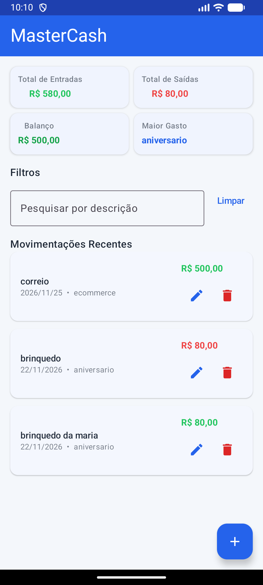

# 💰 MasterCash – Controle Financeiro Android

Aplicativo nativo Android para controle de finanças pessoais, desenvolvido em **Kotlin** com **Jetpack Compose**. Inspirado na página web "Smart Cash", o MasterCash oferece dashboard interativo, cadastro de movimentações, gráficos e persistência local usando **Room** (SQLite).

---



---

## 📱 Funcionalidades

| Funcionalidade | Descrição |
|---|---|
| **Dashboard** | Cards com Total de Entradas, Total de Saídas, Saldo Atual (verde/vermelho) e Maior Categoria de Gasto |
| **Cadastro de Movimentação** | Descrição, valor, tipo (entrada/saída), categoria e data |
| **Edição e Exclusão** | Editar e excluir transações existentes |
| **Filtros** | Busca por descrição e filtro por categoria |
| **Lista de Movimentações** | Todas as transações ordenadas por data com ações de editar/excluir |
| **Gráfico de Evolução** | Gráfico de barras (semanal/mensal) com entradas e saídas |
| **Gráficos por Categoria** | Gráficos de rosca para distribuição de entradas e saídas por categoria |
| **Categorias Fixas + Personalizadas** | Alimentação, Transporte, Moradia, Lazer, Outros + opção de adicionar novas |
| **Persistência Local** | Dados salvos no dispositivo usando Room (SQLite) |
| **Notificações** | Feedback visual para ações (adicionado, atualizado, removido) |
| **Formatação de Moeda** | Valores em reais (R$) com formatação pt-BR |

---

## 🛠️ Tecnologias

| Tecnologia | Finalidade |
|---|---|
| **Kotlin** | Linguagem de programação |
| **Jetpack Compose** | Interface declarativa nativa do Android |
| **Material Design 3** | Sistema de design e componentes |
| **Room** | Banco de dados local SQLite |
| **Hilt** | Injeção de dependência |
| **Navigation Compose** | Navegação entre telas |
| **MPAndroidChart** | Gráficos de barras e rosca |
| **Coroutines** | Programação assíncrona |

---

## 📋 Requisitos

- **Android mínimo:** API 26 (Android 8.0)
- **Android alvo:** API 37
- **Compile SDK:** 37
- **JDK:** 17 ou superior
- **Android Studio:** Giraffe ou superior recomendado

---

## 📁 Estrutura do Projeto

```
app/src/main/java/com/mastercash/mastercash/
  data/           → Entidades Room, DAOs, Database, Hilt Module, Repository
  domain/         → Modelos de domínio
  ui/
    theme/        → Tema Material3
    screen/       → DashboardScreen, FormScreen, GraficosScreen, NavigationScreen
    viewmodel/    → MovimentacaoViewModel com Hilt
  utils/          → FormatUtils (formatação de moeda pt-BR)
app/src/main/res/
  values/         → Cores, strings, temas, dimensões
  drawable/       → Ícones e vetores
  mipmap/         → Ícones do launcher
  xml/            → Regras de backup
```

---

## 🚀 Como Executar

### 1. Abra o Projeto no Android Studio

1. Inicie o **Android Studio**
2. Clique em **"Open"** (Abrir)
3. Selecione a pasta: `/home/goob/Desktop/MasterCash`
4. Clique em **OK**

### 2. Configure o SDK

O Android Studio vai detectar o SDK em `/home/goob/Android/Sdk`. Se necessário:
- Vá em **Tools → SDK Manager**
- Instale **Android 13.0 (API 37)** em SDK Platforms
- Instale **Android SDK Build-Tools 36.0.0** em SDK Tools

### 3. Sincronize o Gradle

O Android Studio vai baixar e configurar o Gradle automaticamente (criando o `gradlew`). Aguarde a sincronização terminar.

### 4. Crie um Emulador ou Conecte um Dispositivo

**Emulador:**
- Tools → Device Manager → Create device → Pixel 7 → API 37 → Finish

**Dispositivo físico:**
- Ative "Depuração USB" nas opções de desenvolvedor do Android
- Conecte via USB

### 5. Execute o Aplicativo

1. Selecione o dispositivo na barra de ferramentas do Android Studio
2. Clique em **▶ Run** (ou `Shift + F10`)
3. Aguarde a instalação

---

## 📦 Arquitetura

O projeto segue o padrão **MVVM** (Model-View-ViewModel):

- **Model:** Entidades Room (`Movimentacao`, `Categoria`) e modelos de domínio
- **View:** Telas em Jetpack Compose (`DashboardScreen`, `FormScreen`, `GraficosScreen`)
- **ViewModel:** `MovimentacaoViewModel` gerencia o estado e a lógica de negócio
- **Repository:** `MovimentacaoRepository` abstrai o acesso aos dados
- **Data:** Room DAOs e banco de dados local

---

## 🎨 Telas

1. **Dashboard** — Resumo financeiro, filtros e lista de movimentações
2. **Nova Movimentação** — Formulário para adicionar ou editar transações
3. **Gráficos** — Evolução semanal/mensal e distribuição por categoria

---

## 🏷️ Categorias

Categorias fixas incluídas:
- Alimentação
- Transporte
- Moradia
- Lazer
- Outros

O usuário também pode adicionar categorias personalizadas a qualquer momento.

---

## 📄 Licença

MIT – sinta-se livre para usar, modificar e distribuir.

---

Desenvolvido por Edilton com 💙 e Kotlin
